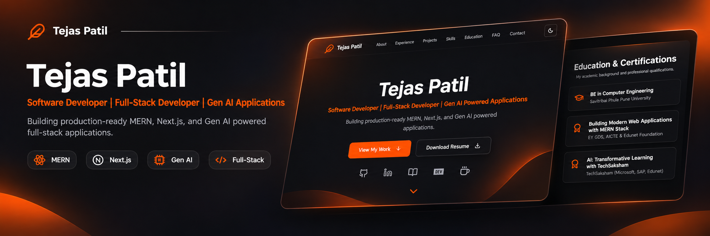
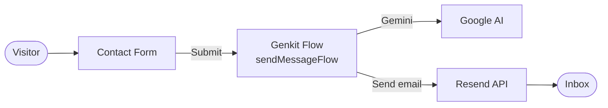

<div align="center">

# Tejas Patil | Portfolio

**A fast, responsive personal portfolio showcasing projects, skills, education, and a working contact form.**




</div>

---

## Overview

This is the personal portfolio of Tejas Patil. It presents projects, skills, education, and certificates in a clean single-page layout, and includes a contact form that delivers messages straight to an inbox.

- Built with **Next.js App Router** and **React Server Components** for fast loads
- Fully **responsive** and accessible UI using ShadCN UI and Tailwind CSS
- **Contact form** powered by Genkit and Resend
- Ready to deploy on **Firebase Hosting**, Vercel, or Netlify

---

## Sections

| Section | What it shows |
|---------|---------------|
| **Hero** | Introduction and quick links |
| **About** | Background and summary |
| **Skills** | Technologies and tools |
| **Projects** | Featured work with links |
| **Education & Certificates** | Academic background and credentials |
| **Contact** | Message form that sends email |

---

## How the Contact Form Works



The form submits to a Genkit flow, which processes the message (using Gemini through `@genkit-ai/googleai`) and sends it by email through Resend.

---

## Tech Stack

| Category | Technology |
|----------|------------|
| **Framework** | [Next.js 15](https://nextjs.org/) (App Router, React Server Components) |
| **Language** | [TypeScript](https://www.typescriptlang.org/) |
| **UI** | [React](https://react.dev/) |
| **Styling** | [Tailwind CSS](https://tailwindcss.com/), [ShadCN UI](https://ui.shadcn.com/) (in `src/components/ui`) |
| **AI** | [Genkit](https://firebase.google.com/docs/genkit) with Google Gemini (`@genkit-ai/googleai`) |
| **Email** | [Resend](https://resend.com/) |
| **Hosting** | [Firebase Hosting](https://firebase.google.com/docs/hosting) |
| **Tooling** | Node.js, npm, ESLint |

---

## Quick Start

### Prerequisites

- **Node.js** 18 or later (LTS recommended)
- **npm** (included with Node.js)
- A [Resend](https://resend.com/) API key and a [Google AI](https://aistudio.google.com/) API key

### 1. Clone and install

```bash
git clone <your-repository-url>
cd <repository-folder-name>
npm install
```

### 2. Add environment variables

Create a `.env.local` file in the project root:

```env
# Resend: sends emails from the contact form
RESEND_API_KEY=your_resend_api_key

# Google AI: used by Genkit and Gemini
GOOGLE_API_KEY=your_google_ai_api_key
```

> **Important:** `.env.local` is already in `.gitignore`. Never commit it.

### 3. Run the app

```bash
npm run dev
```

Open [http://localhost:3000](http://localhost:3000).

### 4. Run Genkit (optional)

Use the Genkit Developer UI to inspect and test flows such as the contact form.

```bash
npm run genkit:dev       # start once
npm run genkit:watch     # restart on file changes
```

The Developer UI is available at [http://localhost:4000](http://localhost:4000).

---

## Scripts

| Command | Description |
|---------|-------------|
| `npm run dev` | Start the Next.js development server |
| `npm run build` | Create a production build |
| `npm run start` | Run the production build |
| `npm run lint` | Check code quality with ESLint |
| `npm run typecheck` | Check for TypeScript errors |
| `npm run genkit:dev` | Start the Genkit Developer UI |
| `npm run genkit:watch` | Start Genkit with auto-reload |

---

## Project Structure

```
.
├── public/                  # Images, resume PDF, certificate images
├── src/
│   ├── app/
│   │   ├── layout.tsx       # Root layout
│   │   ├── page.tsx         # Home page
│   │   └── globals.css      # Global styles and Tailwind theme
│   ├── components/
│   │   ├── layout/          # Header, Footer
│   │   ├── sections/        # Hero, About, Projects, and other sections
│   │   └── ui/              # ShadCN UI components
│   ├── ai/
│   │   ├── genkit.ts        # Genkit setup
│   │   └── flows/           # Genkit flows (e.g. sendMessageFlow.ts)
│   └── lib/                 # Utilities and Firebase config
├── tailwind.config.ts
└── next.config.ts
```

---

## Deployment

The project is ready for **Firebase Hosting**, **Vercel**, or **Netlify**.

1. Build the project with `npm run build`.
2. Deploy using your platform's CLI or Git integration.
3. Add `RESEND_API_KEY` and `GOOGLE_API_KEY` in your hosting provider's environment variable settings.

---

## Editor Setup

The repository includes `.vscode/settings.json` with recommended settings for [VS Code](https://code.visualstudio.com/).

---

## Contact

**Tejas Patil**

- Portfolio: `your-portfolio-url`
- GitHub: [@your-username](https://github.com/your-username)
- LinkedIn: `your-linkedin-url`

---

## License

Released under the [MIT License](./LICENSE).
